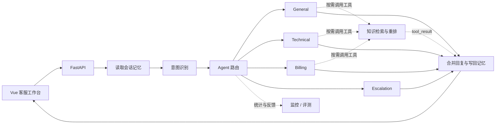

<div align="center">

# mas-agent

**让客服 Agent 的路由、检索与工具调用看得见**

Python 多 Agent 客服系统 · Vue 可视化工作台


[快速开始](#快速开始) · [架构说明](docs/architecture.md) · [场景评测](docs/evaluation.md) · [开发指南](docs/development.md) · [项目来源](docs/provenance.md)

</div>

mas-agent 面向客服与运营问题，将意图识别、知识检索、专业 Agent 协作和会话记忆串成完整链路。前端提供对话、知识库和评测工作台，并展示主 Agent、路由原因、工具调用与响应耗时。

本仓库整理了 **Python 后端 + Vue 前端** 的实现，适合本地演示、代码阅读与进一步开发。

评测支持场景回放、逐项失败定位、可解释 Judge 和固定条件下的调优比较，使用方式见[场景评测](docs/evaluation.md)。合成场景及演示政策仍需业务审核。

当前产品名称为 mas-agent。为兼容已有环境，配置中的 `ECHOMIND_*`、Docker 服务与数据卷名称、浏览器设置键继续沿用既有标识。

## 能力一览

| 能力 | 已有实现 |
| --- | --- |
| 多 Agent 协作 | General、Technical、Billing、Escalation；复合问题并行处理与结果合并 |
| 意图与路由 | LLM、向量相似度分支和规则融合；意图路由、性能反馈与降级 |
| 工具调用 | Anthropic `tool_use` / `tool_result` 循环、工具白名单、参数校验与请求轨迹 |
| RAG | ChromaDB 文档检索、查询改写、并行召回、LLM 重排、缓存与熔断 |
| 分层记忆 | Redis 工作记忆、ChromaDB 历史记忆与用户画像 |
| 动态 Skills | 从 Markdown 业务规则加载能力说明并注入 Agent |
| 可观测与评测 | 完整对话链路、120 条合成场景、证据 Judge、冻结基线、配对实验与可选 Langfuse |

## 请求如何流转



## 快速开始

准备 Docker Compose、Node.js **20.19+ 或 22.12+**，以及能调用 Anthropic Messages 协议的模型服务和 API Key。后端镜像使用 Python 3.12；真实对话和 live 回放会调用所配置的模型，默认场景数据校验不调用模型。

### 1. 启动 Python 后端

```bash
cd backend
cp .env.example .env
```

PowerShell 使用 `Copy-Item .env.example .env`。编辑 `.env`，填写 `ANTHROPIC_API_KEY`，并确认 `ANTHROPIC_MODEL` 是模型服务支持的模型。使用兼容服务时同时设置 `ANTHROPIC_BASE_URL`。

```bash
docker compose up -d --build
docker compose ps
```

- API 健康检查：<http://localhost:8000/health>
- 交互式接口文档：<http://localhost:8000/docs>

首次构建需要下载 Python 依赖与 Chroma embedding 模型。启动失败时执行 `docker compose logs -f echomind` 查看原因。

### 2. 启动 Vue 工作台

另开一个终端，在仓库根目录执行：

```bash
cd frontend
npm ci
npm run dev
```

访问 <http://localhost:5173>。Vite 将 `/api/python` 请求代理到 `http://localhost:8000`。

### 3. 体验主链路

1. 在工作台检查连接，发送“登录时报 401，同时订单被重复扣款”。
2. 查看主 Agent、辅助 Agent、路由原因与工具轨迹。
3. 在知识库中添加一条明确标注为演示的业务政策，再搜索相关问题。
4. 在评测页面校验场景数据；配置模型后显式选择真实回放，查看逐项结果、历史与实验比较。

新实例会自动加载内置演示知识，也可以通过工作台导入自己的文档。仓库不包含原环境的对话、画像、数据库或评测基线。

## 目录导航

```text
backend/
  api/          FastAPI 接口与组件初始化
  agents/       Agent 编排、专业工具、回复合并
  core/         意图识别、LLM 辅助、Skills 加载
  mcp/          项目内工具管理与 ChromaDB 知识库
  memory/       会话记忆与用户画像
  monitor/      指标、告警与路由反馈
  evaluation/   意图与对话评测
  skills/       Markdown 业务规则
  tests/        Agent 编排单元测试
frontend/       Vue 3 + Vite 工作台
docs/           架构、开发与来源说明
```

## 接口速览

| 方法 | 路径 | 用途 |
| --- | --- | --- |
| GET | `/health` | 服务健康检查 |
| POST | `/chat` | 对话、Agent 路由与回复 |
| POST | `/search` | 知识检索 |
| POST | `/knowledge/add`、`/knowledge/upload` | 知识导入 |
| GET | `/knowledge/stats` | 知识库统计 |
| GET | `/skills` | 已加载业务规则 |
| POST | `/skills/reload` | 重新加载规则 |
| GET | `/trace/tool/{request_id}` | 单次请求工具轨迹 |
| GET | `/monitor`、`/metrics` | 运行摘要与指标 |
| POST | `/eval/run` | 运行评测 |

```bash
curl -X POST http://localhost:8000/chat \
  -H "Content-Type: application/json" \
  -d '{"message":"登录时报 401，应该如何排查？","user_id":"demo-user"}'
```

## 实现边界

- 此版本未附带生产级身份认证与租户隔离；默认部署配置用于本地演示。
- 意图识别的向量分支包含本地字符 n-gram 哈希兜底，不等同于专用语义 embedding 服务。
- `mcp/` 是项目内工具管理模块的目录名，并不表示已提供标准 MCP 协议服务。
- 未提供经过实测的准确率、响应延迟或业务收益承诺；评测结果取决于模型、知识库与用例。

## 来源与授权

基于原 EchoMind Python 与前端项目整理，保留来源记录。本次主要整理目录、文档、配置与 Python 前端入口。原始快照未包含许可证，本仓库没有擅自添加新的开源授权。详见[项目来源](docs/provenance.md)。
